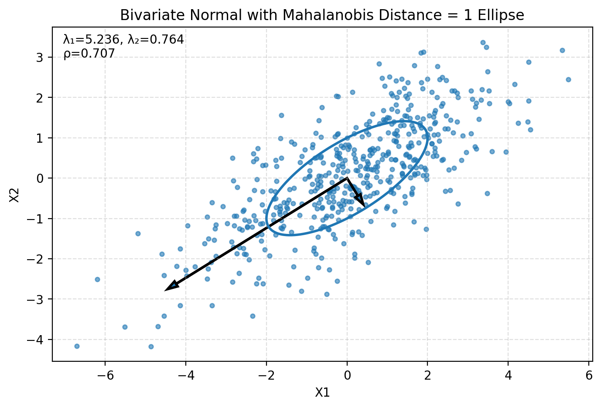
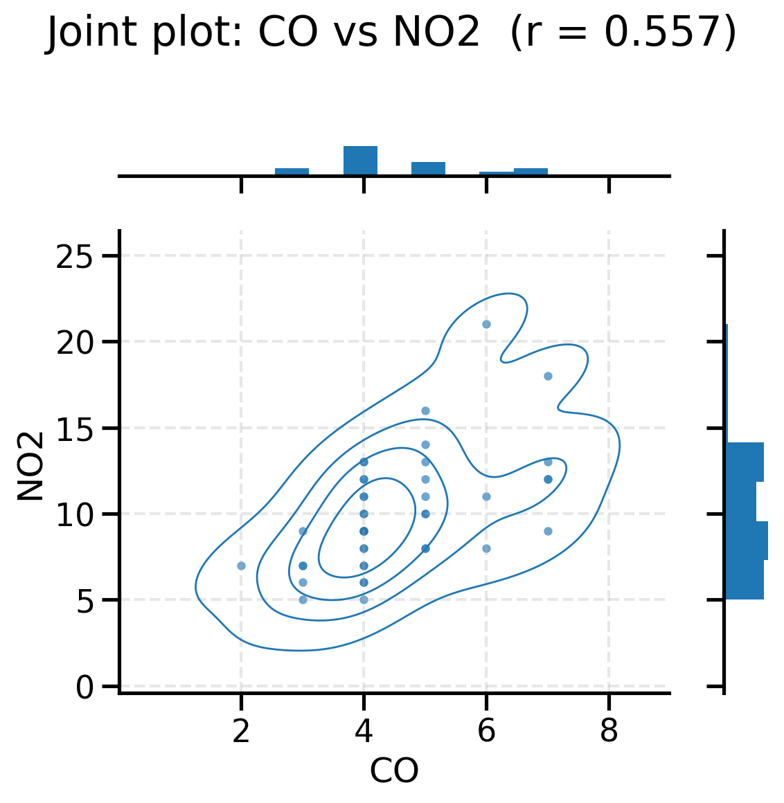

# STTN623 Assignment 1: Multivariate Statistics in Python

Jupyter notebooks for Assignment 1 of **STTN623** at North-West University. The assignment works through core ideas in multivariate statistics: sample covariance and correlation computed from first principles, the geometry of correlation, the properties of covariance matrices, spectral decomposition, linear transformations of random vectors, Mahalanobis-distance ellipses, visual EDA with kernel density estimates, and principal component analysis (PCA).

**Team:** Tafara Kanyemba and Tapiwa Gweshe

## Analysis overview

All seven questions are answered in `Assignment_1.ipynb`. Each one combines code with a short written "Insight" section.

| Question | What is done |
|---|---|
| **Q1** Covariance and correlation | Loads `airpol.csv` and splits the variables into continuous and discrete, treating a variable as continuous if it has more than 10 distinct values. Computes the sample covariance, variances and correlation of NO2 and Solar Rad by hand, interprets the correlation as the cosine of the angle between the centred variable vectors (r ≈ 0.116, angle ≈ 83.4°), plots that angle, and explains why zero covariance means the vectors are orthogonal. |
| **Q2** Covariance matrix properties | Builds the covariance matrix of the continuous variables (Solar Rad, NO2, O3) with explicit loops. Checks that it is symmetric and finds its eigenvalues using power iteration with deflation. All eigenvalues are positive (≈ 304.2, 27.8, 10.9), so the matrix is positive definite. Discusses why Σ is positive semi-definite and what a zero eigenvalue would mean. |
| **Q3** Spectral decomposition | Computes eigenvalues (9, 9, 18) and normalised eigenvectors for a 3×3 symmetric matrix and reconstructs it as A = PDPᵀ. |
| **Q4** Linear transformations | Derives E[AX] = Aμ and Cov(AX) = AΣAᵀ, then evaluates them for a given A, μ and Σ: E[AX] = (1, 9, 3) and Cov(AX) = diag(6, 18, 36), so the transformed variables are uncorrelated. Discusses linear combinations in factor analysis and what zero variance implies. |
| **Q5** Mahalanobis distance | Simulates 500 draws from a bivariate normal with Σ = [[4, 2], [2, 2]] (seed 623). Plots the Mahalanobis-distance-1 ellipse and the eigenvectors scaled by their eigenvalues (λ₁ ≈ 5.236, λ₂ ≈ 0.764, ρ ≈ 0.707), and explains why the contours are ellipses rather than circles. |
| **Q6** Visual EDA | For every `airpol.csv` variable: marginal histograms with KDE, a scatterplot matrix with KDE contours, and a joint plot of the most correlated pair (CO vs NO2, r ≈ 0.557). Concludes that there is moderate collinearity within the pollutants and no clear clustering. |
| **Q7** PCA | Runs PCA on `PCADataset1.csv` using the covariance matrix, which is justified because all variables have roughly equal variance. Four components explain about 86% of the variance and five explain nearly 100%. |

## Project structure

```
Assignment_1.ipynb          # main notebook: Q1-Q7 (title: "STTN623 Assignment 1")
Assignment_1_taps.ipynb     # alternative working version covering Q1-Q6 (see below)
Question_4.ipynb            # standalone working of Q4 (E[AX] and Cov(AX))
airpol.csv                  # air-pollution data: 42 rows; Wind, Solar Rad, CO, NO, NO2, O3, HC
PCADataset1.csv             # 400 rows x 6 variables (X1-X6) for the PCA question
Covariance-Formula.png      # reference image of the population and sample covariance formulas
outputs/
  q5/  Q5_scatter_md1_ellipse_eigenvectors.png, Q5_simulated_data.csv
  q6/  figures/ (histograms, scatterplot matrix with KDE, CO vs NO2 joint plot)
       tables/Q6_correlation.csv
```

`Assignment_1_taps.ipynb` is another version of the same work, covering Q1–Q6 with no Q7 and no title cell. Its main differences are:

- Q1 analyses Wind vs Solar Rad instead of NO2 vs Solar Rad.
- Q5 is written with helper functions.
- Q6 uses a lower-triangle scatterplot matrix.

Both notebooks save their Q5 and Q6 outputs to the same paths under `outputs/`.

## Getting started

Prerequisites: Python 3 and Jupyter.

```bash
pip install -r requirements.txt
jupyter notebook Assignment_1.ipynb
```

Start Jupyter from the repository root, because the notebooks read `airpol.csv` and `PCADataset1.csv` with relative paths. Running the Q5 and Q6 cells creates `outputs/` if needed and overwrites the files in it.

## Results

Selected figures from `outputs/`:

**Q5: bivariate normal sample with the Mahalanobis-distance = 1 ellipse and eigenvectors**



**Q6: joint distribution of the most correlated pair, CO vs NO2**



The marginal histograms are in [`outputs/q6/figures/Q6_histograms.png`](outputs/q6/figures/Q6_histograms.png) and the scatterplot matrix is in [`outputs/q6/figures/Q6_spmatrix_kde.png`](outputs/q6/figures/Q6_spmatrix_kde.png). The full correlation table is [`outputs/q6/tables/Q6_correlation.csv`](outputs/q6/tables/Q6_correlation.csv).

## Notes

- In Q7 of `Assignment_1.ipynb`, the first PCA cell calls `PCA(...)` before the next cell imports it (`from sklearn.decomposition import PCA`). On a fresh *Restart & Run All*, that cell raises a `NameError`. Run the following cell first, or move the import up.
- The notebook marks where generative AI was used to help with some markdown and helper code.
